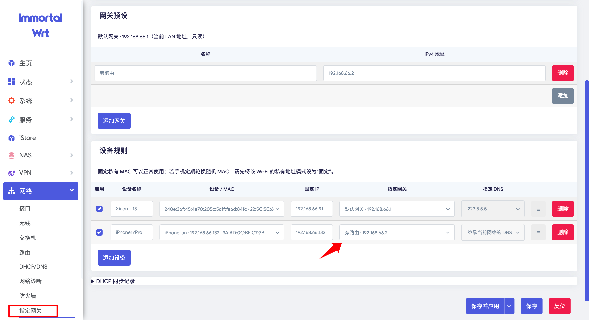
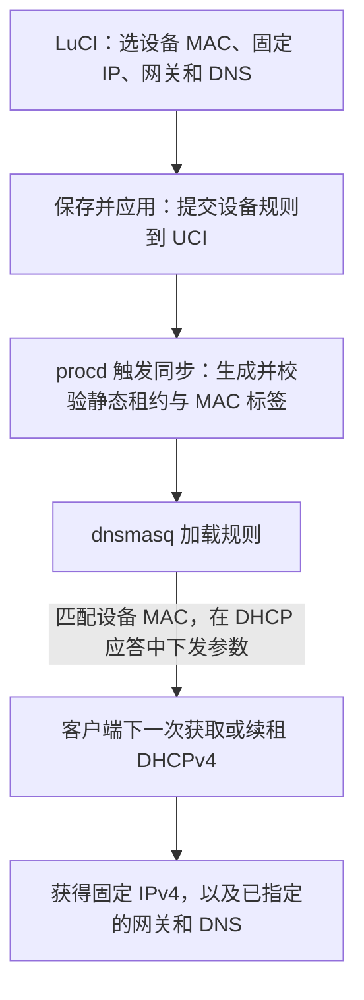

# 指定网关 · luci-app-device-gateway

在 OpenWrt / ImmortalWrt 的 LuCI 中，按设备分配固定 IPv4、默认网关和 DNS。设备规则直接在「网络 → 指定网关」里编辑，插件负责维护 dnsmasq 的 DHCP 标签。

## 为什么做这个插件

以前要给某一台设备指定网关，常遇到三个难点：

1. **命令行有门槛。** 需要登录 SSH，编辑 UCI 或 dnsmasq 配置，再应用变更。没用过命令行的用户很难上手。
2. **在 LuCI 手动打标签步骤多。** 要先找设备的 MAC 和静态租约，再给它加标签，最后为标签填写 DHCP 选项。
3. **有些固件的 DHCP 页面没有「高级设置」。** 即使底层 dnsmasq 支持标签，LuCI 页面也可能没有配置入口。

「指定网关」把这些步骤合并到一张设备规则表。在这里选设备、网关和 DNS，保存并应用后，插件自动维护标签。

## 界面预览



截图里的 iPhone 使用旁路由 `192.168.66.2`，DNS 继承当前网络配置。另一台设备可以同时使用主路由网关和自己指定的 DNS。

## 适合什么场景

| 场景 | 设备规则 |
| --- | --- |
| 只有电视或手机需要走旁路由 | 选择该设备的 MAC 和固定 IP，再选择旁路由网关；其他设备继续使用原来的 DHCP 设置 |
| 家里有两台旁路由，不同设备分别使用 | 把两台旁路由存成网关预设，在设备行里分别选择 |
| NAS、打印机只需要固定地址 | 网关和 DNS 都选择默认或继承 |
| 单台设备需要不同的 DNS | 在「指定 DNS」单独选择常用 DNS，或输入自定义 IPv4 DNS，多个地址用逗号分隔 |

适用于由主路由上的 dnsmasq 提供 DHCPv4 的网络。旁路由必须在设备所在的网段内可达，并已配置转发。插件只下发网络参数，旁路由的转发、防火墙和代理由旁路由自身负责。IPv6 默认路由由 RA 等机制管理，独立于本插件的 IPv4 规则。

## 安装与使用

1. 从 [GitHub Releases](https://github.com/huladabang/luci-app-device-gateway/releases/latest) 下载 `.ipk`。支持 `opkg` 的固件可在软件包页面上传安装，或将安装包放进路由器的 `/tmp` 后执行：

   ```sh
   opkg install /tmp/luci-app-device-gateway_1.0.0-r1_all.ipk
   ```

2. 打开「网络 → 指定网关」。需要旁路由时，点击网关预设表格里的「添加」，填好名称和 IPv4 地址，再点「添加网关」。设备规则也可直接选择默认网关。
3. 添加设备，核对当前 Wi-Fi 使用的 MAC 和固定 IP，按需选择网关与 DNS，然后点「保存并应用」。如果同一 MAC 已有系统静态租约，请沿用它的 IP。
4. 让设备重新获取 DHCP 租约，然后在设备上核对实际收到的 IPv4 网关和 DNS。固定私有 MAC 可以使用，轮换 MAC 的设备需先设为固定模式。

## 兼容性

| 系统 | v1.0.0 支持情况 |
| --- | --- |
| ImmortalWrt 24.10-SNAPSHOT + LuCI 24.10 | **已实测。** TP-Link TL-7DR7299 的 r20 功能验证通过，正式版沿用相同的运行文件。 |
| 官方 OpenWrt 24.10 / 同分支衍生固件 | **可试用。** [上游 dnsmasq 启动脚本](https://github.com/openwrt/openwrt/blob/openwrt-24.10/package/network/services/dnsmasq/files/dnsmasq.init)支持所用的标签配置，其他机型和固件尚未实测。 |
| OpenWrt 23.05 / 22.03 | **待验证。** [23.05](https://github.com/openwrt/openwrt/blob/openwrt-23.05/package/network/services/dnsmasq/files/dnsmasq.init) 和 [22.03](https://github.com/openwrt/openwrt/blob/openwrt-22.03/package/network/services/dnsmasq/files/dnsmasq.init) 都有 DHCP 标签支持，LuCI 页面、应用流程和实际下发仍需联测。 |
| 官方 OpenWrt 25.12 | **现有 IPK 无法直接安装。** 官方已改用 `apk`，需要另行构建 APK 并验证。 [官方发布说明](https://github.com/openwrt/openwrt/releases/tag/v25.12.0) |

发布的 IPK 架构为 `all`，包含 LuCI 页面和脚本。试用其他固件时，需要 LuCI、`opkg`，并由本机 dnsmasq 提供 DHCPv4。同步脚本还需要 `flock`，v1.0.0 的包未声明这一依赖，精简固件可以先用 `command -v flock` 确认。

## 实现原理

下面这张图展示路由器应用规则和设备取得新参数的两个阶段。



LuCI 把预设和设备规则保存在 `/etc/config/device-gateway`。提交后，OpenWrt 的 procd 配置变更事件触发插件同步脚本，脚本按 MAC 为 dnsmasq 生成静态租约和设备标签：

- **固定 IP** 由 DHCP 静态租约提供。已有系统租约的 MAC 在地址相同时会复用原租约；冲突会报错。
- **指定网关** 通过该设备标签下发 DHCPv4 Option 3。选择继承时没有专属 Option 3。
- **指定 DNS** 通过该设备标签下发 DHCPv4 Option 6。选择继承时没有专属 Option 6。

脚本先在临时目录生成并校验规则，再更新 `/etc/config/dhcp`。规则有变化时重启 dnsmasq 并检查 DHCP 监听，失败时尝试恢复上一份配置。插件用 `dg_owner` 标记自己生成的条目，关闭或卸载时清理受管规则并保留原有静态租约。页面底部的「DHCP 同步记录」用于查看路由器侧结果；客户端何时采用新参数取决于 DHCP 续租。

## 从源码构建 IPK

在 macOS 或提供 `bsdtar` 兼容 `tar` 的环境执行：

```sh
./build-ipk.sh
```

产物位于 `dist/`。如需在 OpenWrt 源码树内构建，将本目录放在 `package/luci-app-device-gateway`，在 `make menuconfig` 中选择该插件，再运行 `make package/luci-app-device-gateway/compile V=s`。
