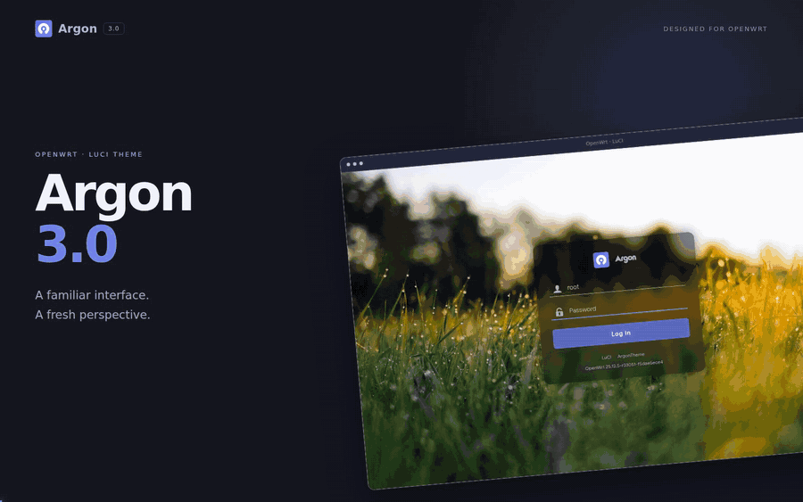
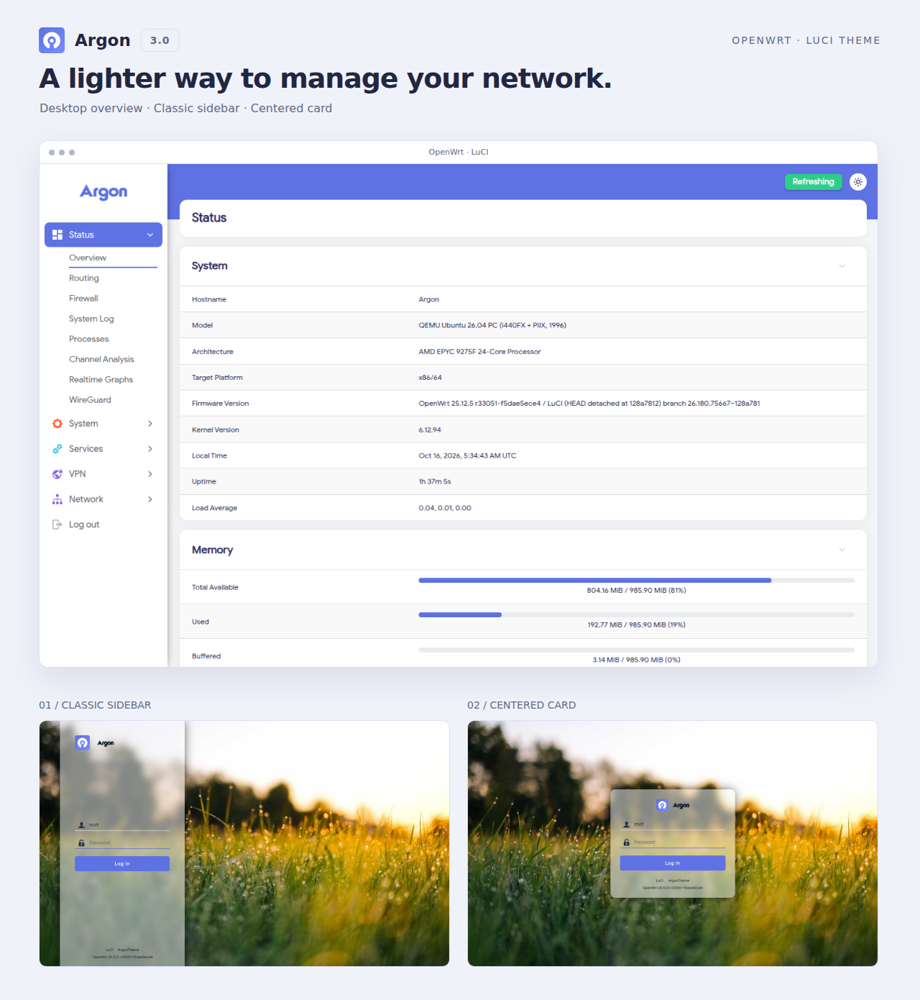
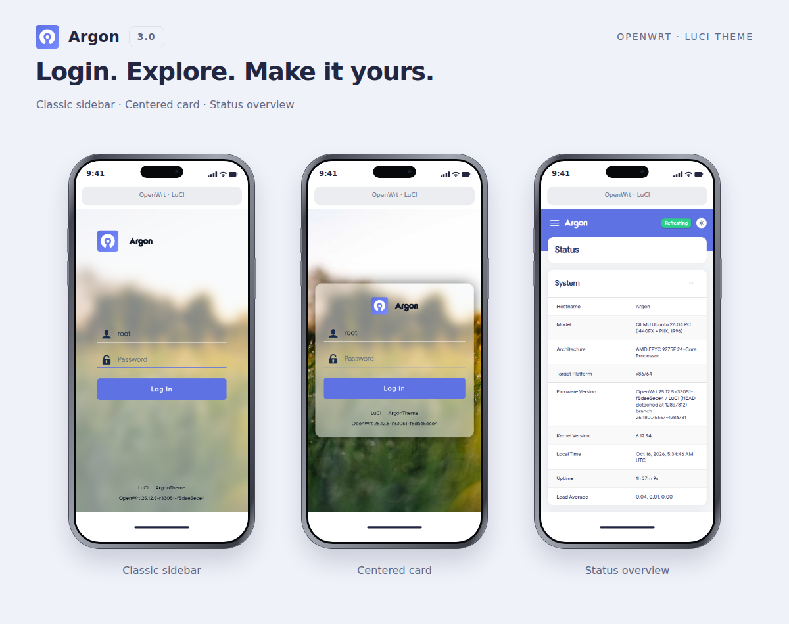
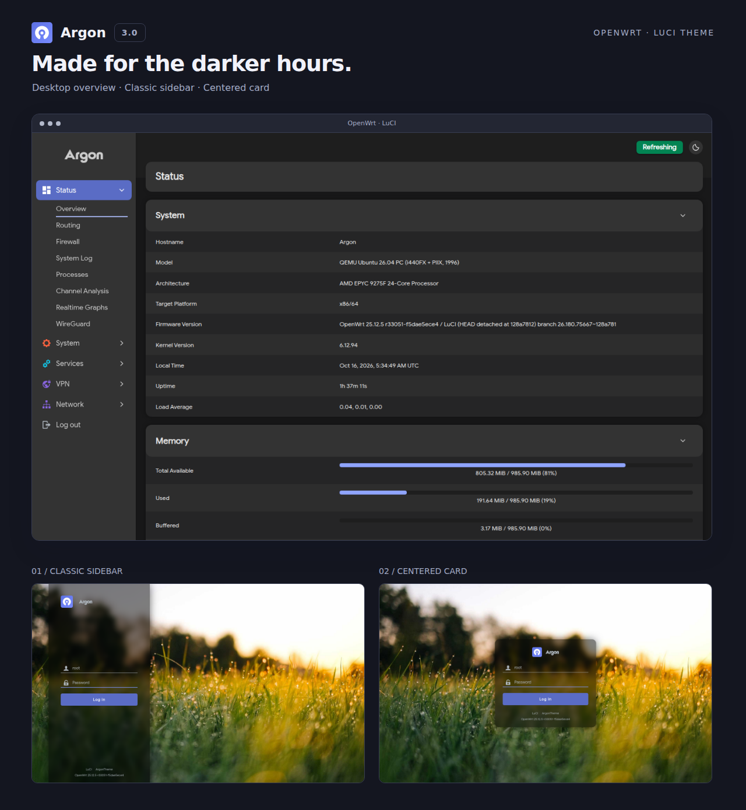
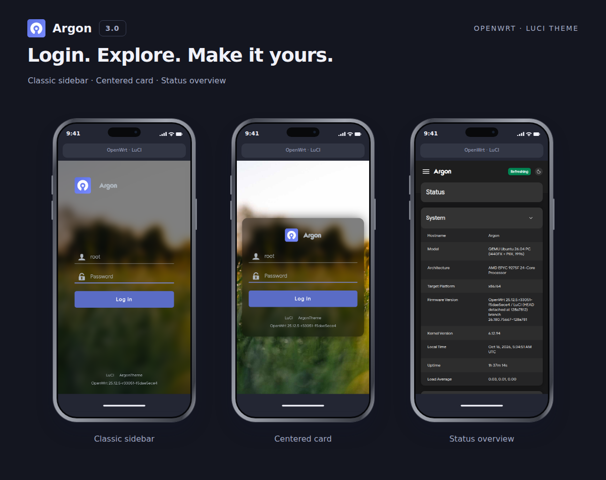

[license]: /LICENSE
[license-badge]: https://img.shields.io/github/license/jerrykuku/luci-theme-argon?style=flat-square&a=1
[prs]: https://github.com/jerrykuku/luci-theme-argon/pulls
[prs-badge]: https://img.shields.io/badge/PRs-welcome-brightgreen.svg?style=flat-square
[issues]: https://github.com/jerrykuku/luci-theme-argon/issues/new
[issues-badge]: https://img.shields.io/badge/Issues-welcome-brightgreen.svg?style=flat-square
[release]: https://github.com/jerrykuku/luci-theme-argon/releases
[release-badge]: https://img.shields.io/github/v/release/jerrykuku/luci-theme-argon?style=flat-square
[download]: https://github.com/jerrykuku/luci-theme-argon/releases
[download-badge]: https://img.shields.io/github/downloads/jerrykuku/luci-theme-argon/total?style=flat-square
[contact]: https://t.me/jerryk6
[contact-badge]: https://img.shields.io/badge/Contact-telegram-blue?style=flat-square

<div align="center">


# A brand new OpenWrt LuCI theme · v3

Argon is **a clean and tidy OpenWrt LuCI theme** that allows<br/>
users to customize their login interface with images or videos.  
It also supports automatic and manual switching between light and dark modes.

[![license][license-badge]][license]
[![prs][prs-badge]][prs]
[![issues][issues-badge]][issues]
[![release][release-badge]][release]
[![download][download-badge]][download]
[![contact][contact-badge]][contact]

**English** · [简体中文](README_ZH.md)

[](Screenshots/argon-3-demo.mp4)

[Watch the desktop demo · MP4](Screenshots/argon-3-demo.mp4)

</div>

## What's new in 3.2

- Admin pages can use a local or online wallpaper. The glass effect has its own switch.
- Sign-in loads a smaller stylesheet. Online wallpapers refresh in the background and fall back to your local media if the image fails.
- Keyboard navigation, high-contrast controls and wireless details work better on small screens.

From v3.1.0 or later, open **System → Argon Config → Theme updates**, select **Check for updates**, then **Update now**. On v3.0.0 or earlier, install v3.2.0 manually once to enable future online updates. See the [release notes](RELEASE.md).

## 3.0 highlights

- **Built-in Argon Config.** Manage the theme without a separate plugin.
- **Broad third-party app support.** Refined layouts, forms and tables for most third-party LuCI apps, with desktop/mobile and light/dark adaptations.
- **Two login layouts.** Choose the classic sidebar or centered card.
- **Light and dark.** Switch from the header or follow your system, with customizable accent colors.
- **Your own look.** Adjust login glass effects, set image or video backgrounds, and upload a browser icon and login logo.
- **Desktop and mobile.** Responsive layouts across screen sizes.

## Install

**In 3.0, the theme and configuration features are one package: `luci-theme-argon`. Fresh installations need only this package.** Download the format matching your firmware's native package manager from [Releases](https://github.com/jerrykuku/luci-theme-argon/releases). If the old standalone configuration plugin is installed, follow the migration steps below first.

| Package manager | Package | Install |
| --- | --- | --- |
| `opkg` | `.ipk` | `opkg install ./luci-theme-argon_*.ipk` |
| APK v3 (`apk-tools 3.x`) | `.apk` | `apk add --allow-untrusted ./luci-theme-argon-*.apk` |

Run `opkg update` or `apk update` first. APK v2 cannot read these APK packages; keep your firmware's native package manager.

For translations, install the matching `luci-i18n-argon-config-<language>` package from the same release and in the same format.

Select **Argon** under **System → System → Language and Style → Design**.

<details>
<summary>Already have the old luci-app-argon-config? Migrate to 3.0</summary>

This applies only when the old standalone configuration plugin is installed. Otherwise, skip this section.

The settings page, colors, backgrounds and branding are all included in the theme. The release's `luci-app-argon-config` is an **empty migration package using the old package name**. It preserves existing settings and hands its files over to the theme.

1. Download both `luci-app-argon-config` and `luci-theme-argon` from the **same release in the theme repository**, in the same format.
2. Put both files in one directory on the router and open a terminal there. **Do not uninstall the old plugin first.** Choose the command pair for your firmware; run the second command only after the first succeeds.

```sh
# opkg
opkg install ./luci-app-argon-config_*.ipk
opkg install ./luci-theme-argon_*.ipk

# APK v3
apk add --allow-untrusted ./luci-app-argon-config-*.apk
apk add --allow-untrusted ./luci-theme-argon-*.apk
```

The first command replaces the old plugin with the empty migration package. The second installs the integrated theme and restores your settings. Continue configuring it under **System → Argon Config**.

</details>

## Customize

Open **System → Argon Config** for login layouts, colors, glass effects, wallpapers and branding. The header's appearance button switches between **Light mode**, **Dark mode** and **Follow system**; the choice also applies to the login page.

Local image and video backgrounds are supported, along with Bing, Unsplash and Wallhaven wallpapers. Unsplash requires an API access key, which is retained when you switch providers. On the first visit with an empty wallpaper cache, the page shows a local background while the router fetches the online image URL for subsequent visits. Browser icons and login logos accept PNG files, 16–1024 pixels per side, up to 1 MiB; browser icons must be square.

On upgrade, an old shared key is migrated to `unsplash_api_key` when the configured source is Unsplash or an Unsplash collection. Otherwise the old value is kept locally as `legacy_wallpaper_api_key`. Confirm which service issued it before re-entering it. Tagged Wallhaven sources configured through UCI use `wallhaven_api_key`.

Under **Theme updates**, check the latest stable release, read its release notes and download the package matching your firmware's package manager.

When a newer version is available, choose **Update now** and confirm to install the theme using the firmware’s native APK or OPKG package manager, preserving your Argon configuration. The page shows download, verification and installation status plus installation logs, and resumes monitoring after a page refresh. Reload the page after installation. The updater downloads and verifies the theme and matching packages for your existing Argon translations before installing them. It also installs the configured LuCI language when that translation is available. Automatic installation requires matching release packages and SHA256 digests and does not downgrade the theme. If verified metadata is missing for an existing translation, update the theme and language packages manually from the same release.

Translations bundled into a firmware's theme package, such as KWRT's Chinese catalog, are preserved during the first upgrade to official packages, including upgrades started by an older updater. A separately installed language package can then take ownership of the catalog.

When building firmware, stop including the old standalone `luci-app-argon-config` plugin alongside the theme: its files conflict with the integrated settings. See [Build with OpenWrt](docs/DEVELOPMENT.md#build-with-openwrt) for existing build scripts.

## Screenshots

Light and dark views of the overview and both login layouts, on desktop and mobile.









## Contributors

<a href="https://github.com/jerrykuku/luci-theme-argon/graphs/contributors">
  
</a>

Made with [contrib.rocks](https://contrib.rocks).

## Development

See the [development guide](docs/DEVELOPMENT.md) for source builds, LESS, templates, icons and checks.

[Releases](https://github.com/jerrykuku/luci-theme-argon/releases) · [Version history](RELEASE.md) · [Contributors](https://github.com/jerrykuku/luci-theme-argon/graphs/contributors) · [Report an issue](https://github.com/jerrykuku/luci-theme-argon/issues)

Licensed under [Apache-2.0](LICENSE). Thanks to [luci-theme-material](https://github.com/LuttyYang/luci-theme-material/).
