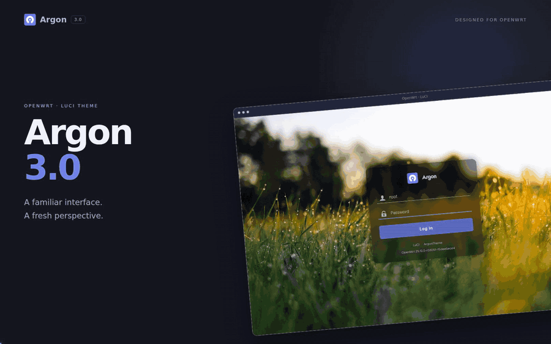
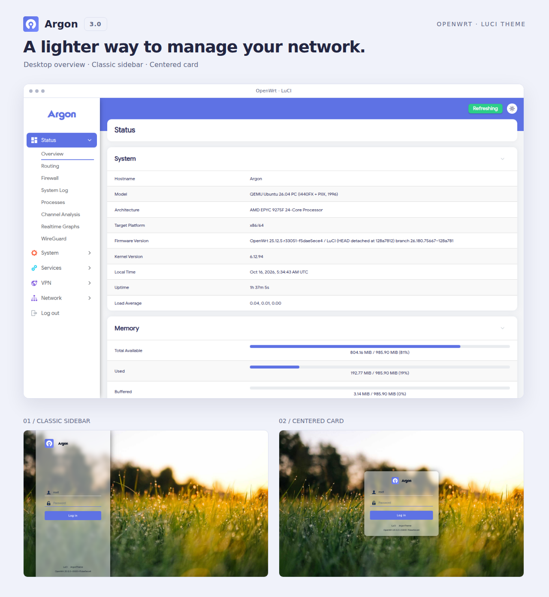
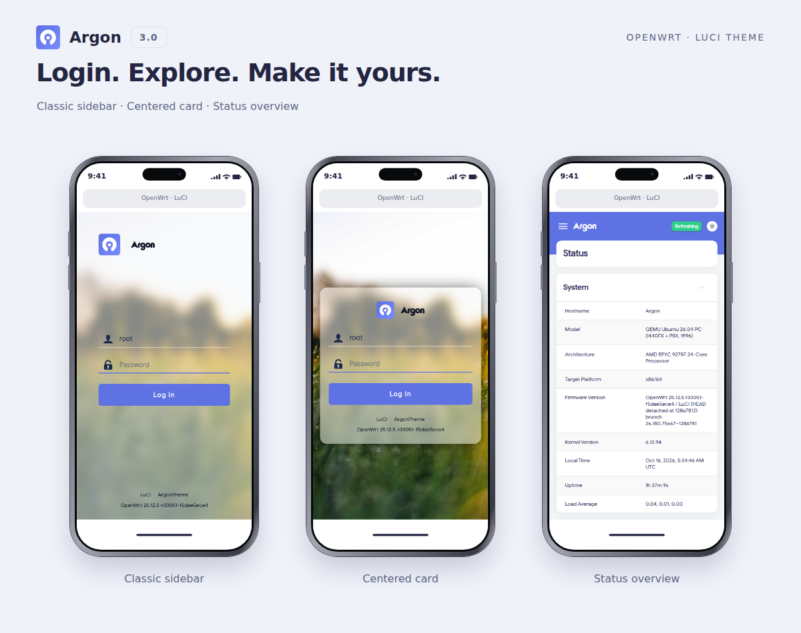
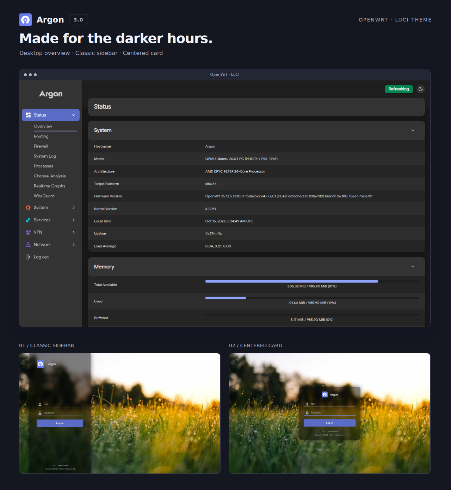
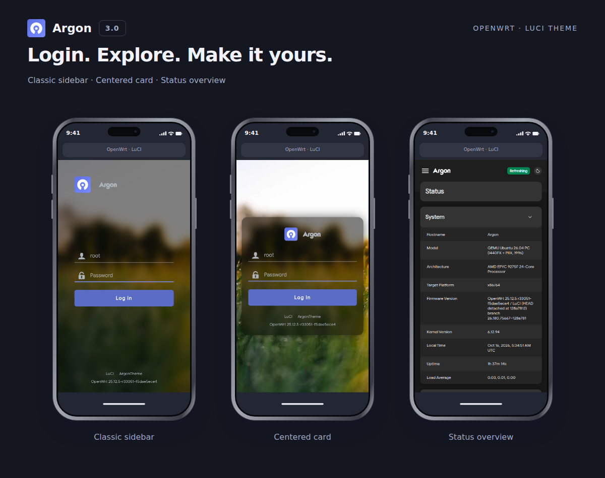

[license]: /LICENSE
[license-badge]: https://img.shields.io/github/license/jerrykuku/luci-theme-argon?style=flat-square&a=1
[prs]: https://github.com/jerrykuku/luci-theme-argon/pulls
[prs-badge]: https://img.shields.io/badge/PRs-welcome-brightgreen.svg?style=flat-square
[issues]: https://github.com/jerrykuku/luci-theme-argon/issues/new
[issues-badge]: https://img.shields.io/badge/Issues-welcome-brightgreen.svg?style=flat-square
[release]: https://github.com/jerrykuku/luci-theme-argon/releases
[release-badge]: https://img.shields.io/github/v/release/jerrykuku/luci-theme-argon?style=flat-square
[download]: https://github.com/jerrykuku/luci-theme-argon/releases
[download-badge]: https://img.shields.io/github/downloads/jerrykuku/luci-theme-argon/total?style=flat-square
[contact]: https://t.me/jerryk6
[contact-badge]: https://img.shields.io/badge/Contact-telegram-blue?style=flat-square

<div align="center">


# 一个全新的 OpenWrt 主题 · v3

Argon 是**一款干净整洁的 OpenWrt LuCI 主题**，  
允许用户使用图片或视频自定义其登录界面。  
它还支持在浅色模式和深色模式之间自动或手动切换。

[![license][license-badge]][license]
[![prs][prs-badge]][prs]
[![issues][issues-badge]][issues]
[![release][release-badge]][release]
[![download][download-badge]][download]
[![contact][contact-badge]][contact]

[English](README.md) · **简体中文**

[](Screenshots/argon-3-demo.mp4)

[观看桌面演示 · MP4](Screenshots/argon-3-demo.mp4)

</div>

## 3.0 新特性

- **内置 Argon Config**：主题设置随主题安装，无需独立插件。
- **广泛适配第三方应用**：针对大多数第三方 LuCI 应用优化布局、表单和表格，兼顾桌面、手机与亮暗模式。
- **两套登录界面**：经典侧栏与居中卡片，自由选择。
- **亮暗配色**：顶部快捷切换或跟随系统，支持自定义主色。
- **个性化外观**：调节毛玻璃效果，设置图片或视频背景，上传网站图标和登录 Logo。
- **桌面与手机适配**：适应不同屏幕尺寸的响应式布局。

## 安装

**3.0 已将主题和配置功能合并到 `luci-theme-argon`，全新安装只需这一个包。** 前往 [Releases](https://github.com/jerrykuku/luci-theme-argon/releases) 下载与固件原生包管理器匹配的格式。已有旧版独立配置插件的用户，请先按下方迁移步骤操作。

| 包管理器 | 包格式 | 安装命令 |
| --- | --- | --- |
| `opkg` | `.ipk` | `opkg install ./luci-theme-argon_*.ipk` |
| APK v3（`apk-tools 3.x`） | `.apk` | `apk add --allow-untrusted ./luci-theme-argon-*.apk` |

安装前执行 `opkg update` 或 `apk update`。APK v2 无法读取本项目的 APK 包，请沿用固件原生包管理器。

需要翻译时，安装同次发行、相同格式的 `luci-i18n-argon-config-<语言>` 语言包。

在 **系统 → 系统 → 语言和界面 → 主题** 中选择 **Argon**。

<details>
<summary>已安装旧版 luci-app-argon-config？如何迁移到 3.0</summary>

仅适用于已安装旧版独立配置插件的用户；没有安装过该插件可跳过。

3.0 的设置页面、配色、背景和 Logo 管理都在主题包内。发行附件中的 `luci-app-argon-config` 是**沿用旧包名的空迁移包**，用于保留旧配置并将文件交给主题，不是另一个配置插件。

1. 从**主题仓库同一次 3.0 发行**中下载 `luci-app-argon-config` 迁移包和 `luci-theme-argon` 主题包，格式一致。
2. 将两个文件放到路由器同一目录，在该目录打开终端。**无需先卸载旧插件**，按固件选择下面一组命令；第一条成功后，再执行第二条。

```sh
# opkg
opkg install ./luci-app-argon-config_*.ipk
opkg install ./luci-theme-argon_*.ipk

# APK v3
apk add --allow-untrusted ./luci-app-argon-config-*.apk
apk add --allow-untrusted ./luci-theme-argon-*.apk
```

第一步将旧插件升级为空迁移包，第二步安装包含配置功能的新主题，并恢复已有设置。之后继续在 **系统 → Argon 主题设置** 中配置即可。

</details>

## 自定义

打开 **系统 → Argon 主题设置**，调整登录布局、配色、毛玻璃、壁纸和图标。页面右上角可切换**亮色模式、暗色模式、跟随系统**，也会应用于登录页。

背景支持本地图片、视频，以及 Bing、Unsplash、Wallhaven 在线壁纸；Unsplash 需填写 API Access Key。网站图标和登录 Logo 支持 PNG，每边 16–1024 像素、最大 1 MiB，网站图标需为正方形。

## 效果展示

亮暗两色，展示桌面与手机端的首页和两套登录界面。









## 贡献者

<a href="https://github.com/jerrykuku/luci-theme-argon/graphs/contributors">
  
</a>

Made with [contrib.rocks](https://contrib.rocks).

## 开发

源码构建、LESS、模板、图标和检查说明见[开发文档](docs/DEVELOPMENT_ZH.md)。

[下载](https://github.com/jerrykuku/luci-theme-argon/releases) · [版本历史](RELEASE_ZH.md) · [贡献者](https://github.com/jerrykuku/luci-theme-argon/graphs/contributors) · [反馈问题](https://github.com/jerrykuku/luci-theme-argon/issues)

采用 [Apache-2.0](LICENSE) 许可证。感谢 [luci-theme-material](https://github.com/LuttyYang/luci-theme-material/)。
