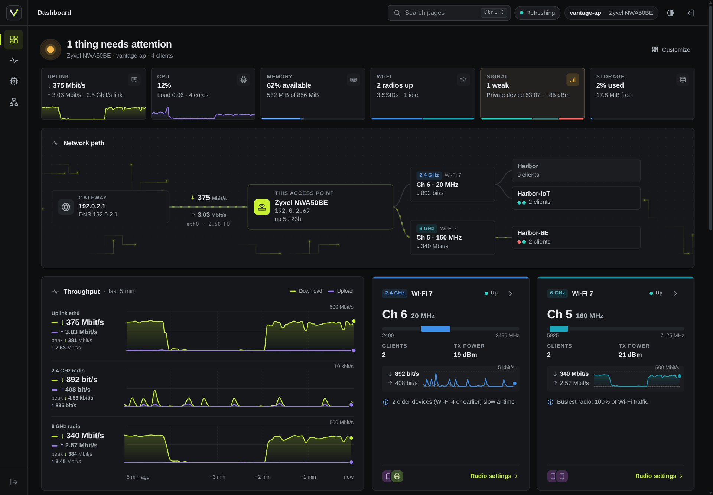
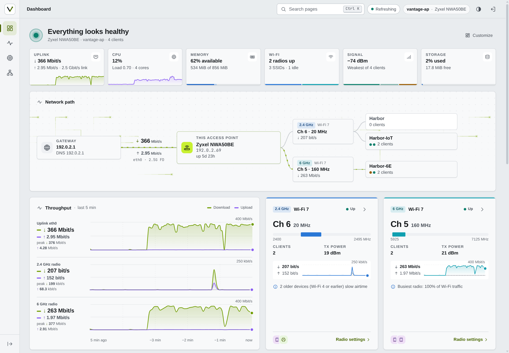
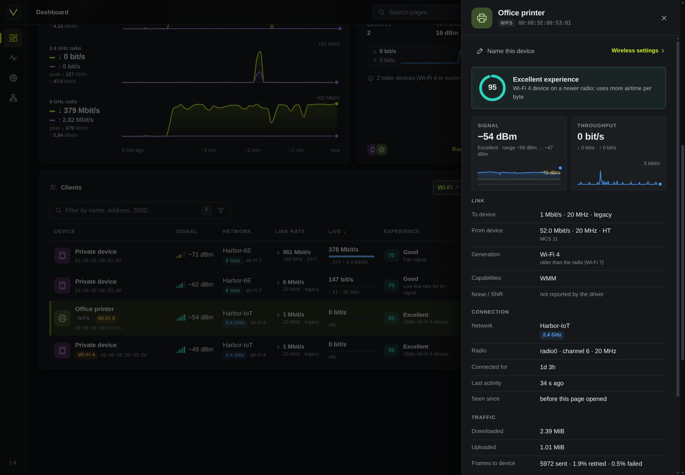
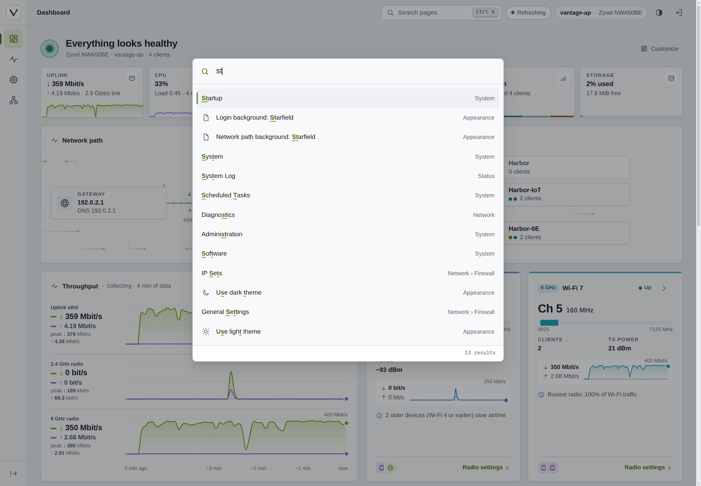
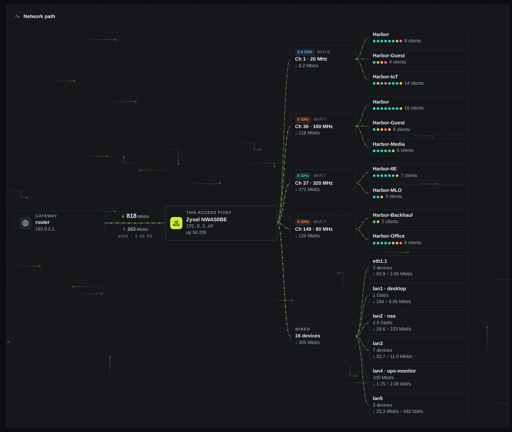
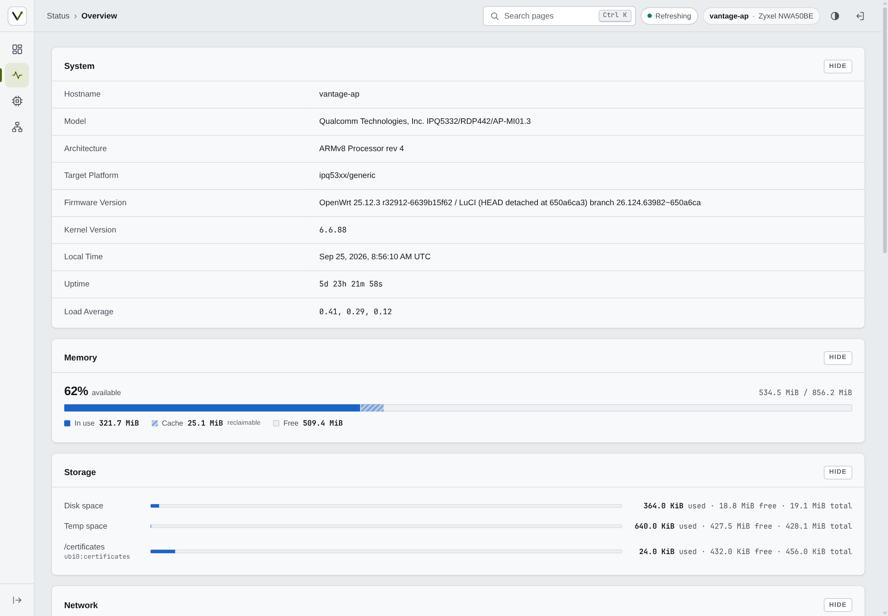
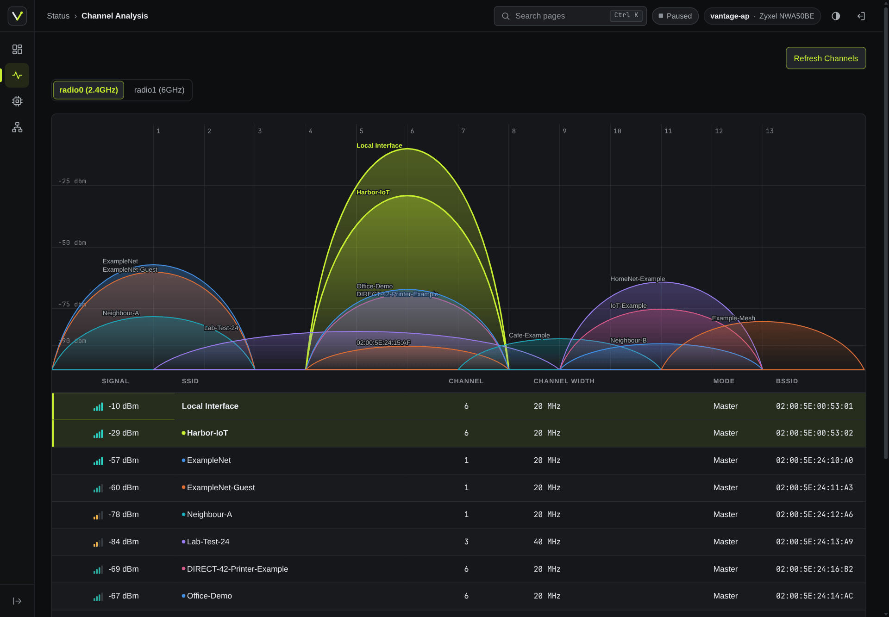
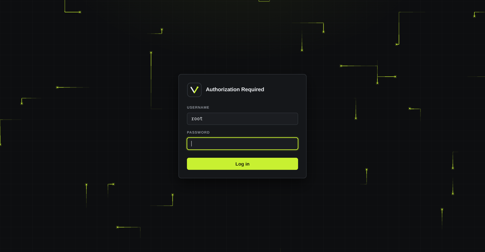
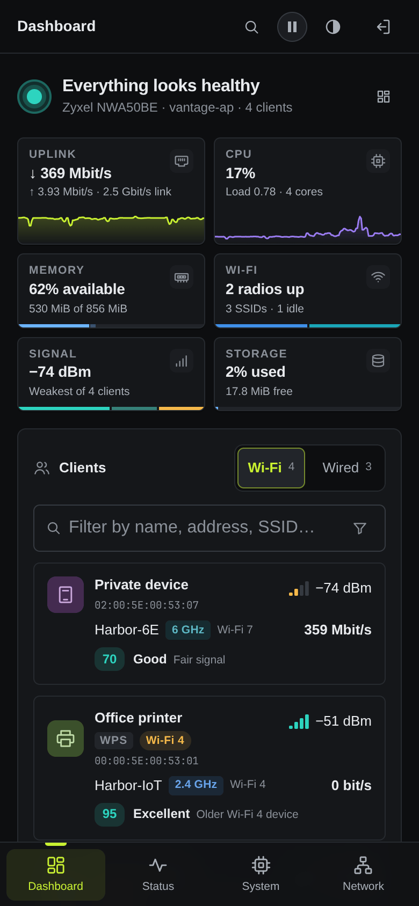

<div align="center">


# Vantage

**A theme and live dashboard for LuCI, OpenWrt's web interface. Log in and see who's connected, how busy your connection is, and what needs fixing. For OpenWrt 25.12 and 24.10.**

  

[Website](https://anothadev.github.io/luci-theme-vantage/) · [Install](#install) · [Screenshots](#screenshots) · [Changelog](CHANGELOG.md)

</div>

<br>

<p align="center">
  <a href="https://anothadev.github.io/luci-theme-vantage/"></a>
</p>

<p align="center"><sub>The video and screenshots use recorded data with addresses and names
replaced. The larger access point further down is generated.</sub></p>

## What you get

Two packages that work together or alone: the theme doesn't need the
dashboard, and the dashboard on its own works under any LuCI theme.

**The dashboard** (`luci-app-vantage`) is the page you land on after login.

- **Health at a glance.** Six checks: uplink, CPU, memory, Wi-Fi, client
  signal and storage. Each gives a one-line reason, and clicking it opens
  the details.
- **A live network path.** Your internet lines, this device, its radios
  and SSIDs, and its wired ports, with packets that move at the real
  uplink rate. Click anything for details.
- **Every client, by name.** Your alias, a name from DHCP, mDNS, WPS or
  reverse DNS, or else the vendor. You get signal, link rate, Wi-Fi
  generation, live traffic and an experience score that explains itself.
  Wired devices are listed too, with their port and link speed.
- **Live charts.** Five minutes of throughput for the uplink and every
  radio, in the chart style you choose, plus radio cards, top talkers and
  a system tile.
- **Firewall overview.** What's open from the internet, which zones reach
  which, and warnings for risky setups. Every item links to the LuCI page
  that changes it.
- **Your own layout.** Drag, resize or hide tiles, with one layout per
  screen size. With the Vantage theme, your layout and chart style are
  saved on the router, so every browser matches.

**The theme** (`luci-theme-vantage`) restyles every LuCI page.

- **Quick to get around.** An icon rail, breadcrumbs, and
  <kbd>Ctrl</kbd>+<kbd>K</kbd> or <kbd>/</kbd> to search every page you
  can open.
- **Good on phones.** A bottom bar replaces the rail, and tables become
  cards.
- **Light, dark or auto**, with no flash on load. Your choice and your
  background picks are saved on the router, so every browser matches.
- **Tidier stock pages.** One control size, one tab style, field help
  folded to its first line, spare row actions tucked into a ⋯ menu, and
  coloured firewall verdicts.
- **Its own login page**, with moving packets, a starfield or nothing.

Nothing loads from the internet: Vantage uses system fonts and its own
icons, with no CDNs or frameworks. The one exception is **Check for
updates** under Appearance, and only when you click it. The dashboard's only write is device
names, and it never reads Wi-Fi keys. See [Security](#security).

## Install

These steps are for OpenWrt 25.12 (apk). On 24.10, follow the
[24.10 steps](docs/INSTALL.md#openwrt-2410). Both packages are
architecture-independent, so the same files install on any router.

**From the signed repository.** Run this on the router. It stops before
installing anything if the key's hash doesn't match. You only need to do it
once; later versions come with `apk upgrade`.

```sh
key=$(mktemp) &&
wget -O "$key" https://anothadev.github.io/luci-theme-vantage/vantage-signing.pem &&
echo "c8a6c83eeb49ca2407932fb5e95785776128cef87db75ebaea0fe4171eee2157  $key" | sha256sum -c - &&
cp "$key" /etc/apk/keys/vantage-signing.pem &&
echo 'https://anothadev.github.io/luci-theme-vantage/25.12/packages.adb' >> /etc/apk/repositories.d/customfeeds.list &&
apk update &&
apk add luci-theme-vantage luci-app-vantage
```

**From release files.** Download them from a
[release](https://github.com/anothaDev/luci-theme-vantage/releases) or
[build your own](#build), then run this in the same folder. `192.0.2.1`
stands for your router's address.

```sh
f=$(awk '/ luci-(theme|app)-vantage-.*\.apk$/ {print $2}' SHA256SUMS) &&
grep -E ' luci-(theme|app)-vantage-.*\.apk$' SHA256SUMS | sha256sum -c - &&
ssh root@192.0.2.1 'mkdir -m 700 /tmp/vantage' &&
scp -O $f root@192.0.2.1:/tmp/vantage/ &&
ssh root@192.0.2.1 'apk add --no-network --allow-untrusted /tmp/vantage/*.apk; s=$?; rm -r /tmp/vantage; exit $s'
```

Log out of LuCI and back in, and the dashboard is your landing page. A
fresh install switches to the theme for you. An upgrade keeps the theme
you chose, and removing the theme switches LuCI back to Bootstrap.

**[The install guide](docs/INSTALL.md)** covers the rest: requirements,
verifying packages, installing just one of them, upgrades, uninstalling,
building Vantage into your own firmware, troubleshooting, and a
ready-made prompt for installing with a coding agent.

## Screenshots

<p align="center">
  
</p>

<table>
  <tr>
    <td width="50%"></td>
    <td width="50%"></td>
  </tr>
  <tr>
    <td align="center"><sub>Light mode: health checks, network path and live throughput</sub></td>
    <td align="center"><sub>Client details: experience score, signal and link info</sub></td>
  </tr>
  <tr>
    <td width="50%"></td>
    <td width="50%"></td>
  </tr>
  <tr>
    <td align="center"><sub><kbd>Ctrl</kbd>+<kbd>K</kbd> search over pages and Appearance options</sub></td>
    <td align="center"><sub>A larger access point (generated): four radios, ten networks, six wired ports</sub></td>
  </tr>
  <tr>
    <td width="50%"></td>
    <td width="50%"></td>
  </tr>
  <tr>
    <td align="center"><sub>LuCI's Status page under the theme, with a combined memory bar</sub></td>
    <td align="center"><sub>LuCI's Channel Analysis page (neighbouring networks are generated)</sub></td>
  </tr>
  <tr>
    <td width="50%" valign="middle"></td>
    <td width="50%" align="center"></td>
  </tr>
  <tr>
    <td align="center"><sub>Login page with grid packets, a starfield or nothing</sub></td>
    <td align="center"><sub>Phone layout with the bottom bar and Wi-Fi/Wired switch</sub></td>
  </tr>
</table>

## Security

Vantage is built to read your router, not change it. The full rules are in
the [spec](docs/SPEC.md#6-security-requirements).

- **The dashboard only reads.** Its permissions cover read methods and
  can't run commands. Its one write is device names, stored in
  `/etc/config/vantage`.
- **Wi-Fi keys stay out.** Wireless settings come through Vantage's own
  plugin, which leaves out Wi-Fi keys, SAE passwords and RADIUS secrets.
- **The theme writes one file.** Appearance, and the dashboard's layout
  and chart style, go to `/etc/config/vantage_theme` and nowhere else. A
  user without that permission keeps their picks in their own browser.
- **Extras are separate permissions.** Renaming devices
  (`luci-app-vantage-names`) and reverse DNS (`luci-app-vantage-rdns`) are
  their own groups, so you can leave them out. The firewall overview only
  appears for users who already hold LuCI's firewall permission.
- **Checked by tests.** They reject HTML built from data, render the
  theme's templates with hostile input, confirm the permissions match what
  the code calls, and keep real addresses, MACs and SSIDs out of the
  repository.

One known exception: LuCI's own header adds its `L.env` script to every
page, including the menu tree on logged-out 404 pages. That's upstream
behaviour, tracked in [`docs/luci-contract.md`](docs/luci-contract.md).

## Compatibility

| OpenWrt | Status |
|---|---|
| 25.12 | Built with the 25.12 SDK and tested |
| 24.10 | Signed `.ipk` packages, built with the 24.10 SDK and tested on a 24.10.8 router without Wi-Fi ([install](docs/INSTALL.md#openwrt-2410)) |

## Languages

Vantage is available in English and Simplified Chinese (dashboard
translation by [@ntbowen](https://github.com/ntbowen)). Each language
installs as its own packages, for example
`apk add luci-i18n-vantage-zh-cn luci-i18n-vantage-theme-zh-cn`; see
[Languages](docs/INSTALL.md#languages) in the install guide.

Translations are very welcome. In a fork, run
`dev/i18n/update.sh --add <lang>`, translate the two new `.po` files and
open a pull request that touches only `po/` files.
[Translations](CONTRIBUTING.md#translations) has the details.

## Build

With podman and the official OpenWrt SDK image:

```sh
dev/build/sdk-build.sh 25.12.4          # builds HEAD into dist/25.12.4/
```

The same commit and SDK always produce byte-identical packages, and each
package is checked against the source before it reaches `dist/`. Signing
and the other details are in the
[install guide](docs/INSTALL.md#build-from-source).

## Develop

You don't need a router to work on Vantage. The replay in `dev/replay/`
serves the full LuCI interface from a recording or hand-written fixtures,
with the theme and app loaded from this repository, so you can reload to
see an edit. `--demo` swaps real addresses and names for documentation
values, which is how the screenshots were made.

```sh
node dev/replay/server.js --mirror ../vantage-mirror --port 8106 --demo \
    --theme-dir luci-theme-vantage/htdocs/luci-static/vantage --theme vantage \
    --app-dir luci-app-vantage
```

[`CONTRIBUTING.md`](CONTRIBUTING.md) has the setup and the checks to run,
[`docs/SPEC.md`](docs/SPEC.md) describes the product, and
[`docs/luci-contract.md`](docs/luci-contract.md) lists what LuCI expects
from a theme. Coding agents should read [`AGENTS.md`](AGENTS.md).

## Contributing

Issues and pull requests are welcome; see
[`CONTRIBUTING.md`](CONTRIBUTING.md). For a bug report, include your
OpenWrt version (`cat /etc/openwrt_release`), your browser, and screenshots
with personal data removed: no real IP addresses, MACs or SSIDs. Report
security problems privately as described in [`SECURITY.md`](SECURITY.md),
not in a public issue.

Past releases are in [`CHANGELOG.md`](CHANGELOG.md), and planned work is in
[`docs/ROADMAP.md`](docs/ROADMAP.md).

## License

GPL-3.0-or-later. See [`LICENSE`](LICENSE) and
[`luci-theme-vantage/NOTICE`](NOTICE).
